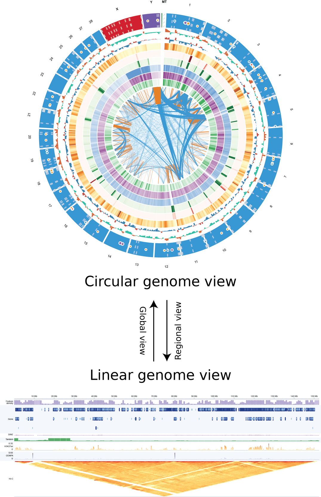

# genome-building-pipeline

Code for a de novo genome-building pipeline — assembly & scaffolding, repeat
masking, and genome annotation — for the degu (*Octodon degus*).

## Genome browser

Many of the genome-assembly results are presented interactively in the **degu
genome browser** — the final assembly, CENPA / H3K27ac BigWig signal tracks, the
Hi-C contact matrix, and segdup / HOR / structural-error annotation tracks:

  <a href="https://renlab.sdsc.edu/share/jhc103/degu-genome-browser/">Octodon degus genome browser</a>

  

## Repository layout

- `01-genome-assembly/` — assembly (hifiasm), Hi-C preprocessing, scaffolding (HapHiC), mitochondrial filtering, sex-chromosome identification
- `02-genome-assembly-initial-evaluation/` — initial assembly QC (Merqury, BUSCO, coverage, GenomeScope, Hi-C contact maps)
- `03-genome-annotation/` — repeat masking, transfer- and de novo-based annotation
- `04-genome-annotation-initial-evaluation/` — annotation evaluation (read-depth tracks, pie/density plots, GO enrichment, evolutionary placement, synteny)
- `05-genome-assembly-indepth-assessment-contam-filtering/` — in-depth assembly assessment (contamination filtering, purging, polishing, paralog screens, structural-error detection)
- `06-tandem-repeat-analysis/` — tandem-repeat analysis (TRF, centroAnno, CENP-A)
- `07-segmental-duplication-analysis/` — segmental-duplication analysis (BISER)
- `08-pyCirclize-plots/` — pyCirclize circos plots (genomic / tandem-repeat / segdup features)
- `100-inputs-files/` — input data pointers (reads, assemblies, references, annotations)
- `100-outputs-genome-information/` — generated genome information (BUSCO, Merqury, centroAnno, segdup, TRF, …)
- `200-degu-genome-browser/` — static D3 degu genome browser (frontend + embedded segdup data)

## Main figures

Each figure panel produced in code has a standalone script that draws it at its printed
size (Genome Research: 8 pt Helvetica, PDF + SVG + 600-dpi PNG). Panels marked
*outside code* were made by hand (Google Slides / Illustrator / Juicebox).

| Figure | Panel | Script | Output folder |
|---|---|---|---|
| 1 | A, B | *outside code* (pipeline diagram; Hi-C map) | |
| 1 | C | `01-genome-assembly/04-sexChr-identification/01-synteny-to-sex-chr/02_plot_figure1C_synteny.py` | `…/01-synteny-to-sex-chr/figure1C/` |
| 1 | D | `01-genome-assembly/04-sexChr-identification/02_plot_figure1D_coverage.py` | `…/04-sexChr-identification/figure1D/` |
| 1 | E | `01-genome-assembly/04-sexChr-identification/03_plot_figure1E_female_absent_kmers.py` | `…/figure1E/` |
| 1 | F | `01-genome-assembly/04-sexChr-identification/04_plot_figure1F_sry_blast.py` (BLAST: `04_blastSryGenes.sh`) | `…/figure1F/` |
| 2 | A | *outside code* (annotation pipeline) | |
| 2 | B | `04-genome-annotation-initial-evaluation/02_prepare_figure2B_density.py` → `02_plot_figure2B_density.py` | `04-…/figure2B/` |
| 2 | C | `04-genome-annotation-initial-evaluation/01-annotation-piechart-breakdown/02_plot_figure2C_annotation_pie.py` | `…/figure2C/` |
| 2 | D, E | `04-…/03_go_enrichment_novel_genes.py` → `04_prepare_figure2DE_go_clusters.R` → `04_plot_figure2D_go_pcoa.R`, `04_plot_figure2E_go_barplot.py` | `04-…/figure2DE/` |
| 3 | A–D | `04-genome-annotation-initial-evaluation/08-genome-comparison-with-octDeg1/01–04_*.py` (see its README) | `…/figure3/` |
| 4 | A | `06-tandem-repeat-analysis/02_repeat_analysis/01_plot_figure4A_trf_scatter.py` | `06-…/figure4/` |
| 4 | B, C | `06-…/03_repeat_cenpa_analysis/cenpa-cuttag-enrichment/period-enrichment/scripts/period_array_count_length.R`, `period_violin_array.R` | `06-…/figure4/` |
| 4 | D, E | `06-…/03_repeat_cenpa_analysis/cenpa-repeat-chromosome/11_prepare_figure4DE_intervals.py` → `12_plot_figure4DE_intervals.py` | `06-…/figure4/` |
| 5 | A | `07-segmental-duplication-analysis/02_analysis/05b_plot_figure5A_cumulative.py` | `07-…/figure5/` |
| 5 | B | `07-…/02_analysis/06b_plot_figure5B_go_dotplot.py` | `07-…/figure5/` |
| 5 | C | `07-…/02_analysis/11b_plot_figure5C_circos.py` | `07-…/figure5/` |
| 5 | D | `07-…/02_analysis/12b_plot_figure5D_expression_violin.py` | `07-…/figure5/` |

All paths and colours come from `config.sh`. Generated figures and caches of
embargoed data are not tracked; run the scripts to regenerate them.

## Configuration

Edit `config.sh` (repository root) to set paths, conda environments, and cluster
settings for your environment. Every pipeline script finds and sources it
automatically, so you do not need to edit the scripts themselves.

## Notes

- Scripts are Slurm batch scripts written for the TSCC cluster at UCSD; adjust
  the `#SBATCH` scheduler lines for your own cluster.
- Folder names use hyphens (`-`), file names use underscores (`_`).
